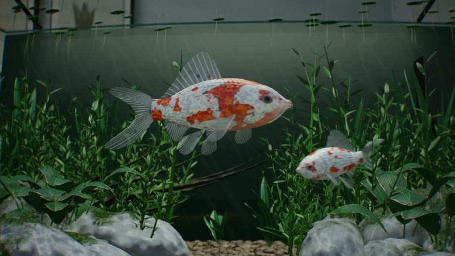

# Rental Cat POV · 猫眼出租屋

一段 20 秒的猫视角短片。猫把毛线球拍开，追到鱼缸旁轻轻叫了一声。玻璃前的大鱼先甩尾，小鱼晚约三帧游向另一侧。猫随后跳上沙发，蜷起来入睡。



房间、家具、水草、鱼鳞、毛线球、猫爪和镜头运动都由代码生成。成片为 1600 × 900、24 fps，共 480 帧，每像素 320 次采样。音轨把猫叫和猫脚步的现场录音与程序生成的毛线、布料声混合。

## 在 Mac 上运行

需要 Apple Silicon、Metal、Xcode Command Line Tools、Python 3、NumPy 和带 libx264 的 FFmpeg。正式画质还用到 Open Image Denoise 2.x。下面的命令在仓库根目录执行。

```bash
brew install python ffmpeg open-image-denoise
python3 -m venv .venv
source .venv/bin/activate
python -m pip install numpy
python tools/build.py
```

构建脚本从 Cat Garden 的固定提交读取渲染器并逐文件校验 SHA-256，再在本地接入房间和着色器扩展。如果已经下载了该版本，可运行 `python tools/build.py --upstream /path/to/cat-garden/src`。[Cat Garden 基线](https://github.com/BubbleBrainBB/awesome-fable-5.2/tree/00688eb6aef1dacad5c7f3d726f8b642f911c131/cat-garden)

### 先看鱼缸镜头

```bash
(cd build && ./catcam --film --fps 24 --from 192 --to 192 --w 960 --h 540 --spp 32 --exp 1.14 --out aquarium.ppm)
```

第 192 帧是叫声前的第 8 秒。将帧号换成 207 可以看两条鱼散开的动作。

### 导出整段视频

```bash
tools/render.sh --preview  # 640 × 360 带声音的动作预览 → build/preview.mp4
tools/render.sh            # 1600 × 900，320 spp，带降噪 → build/rental-cat-pov.mp4
```

正式渲染需要数小时，建议预留 6 GB 磁盘空间。若中断，重新运行同一命令可从上次写完的原始帧继续。修改场景或镜头后，请换用新的输出目录或移走 `build/raw` 再渲。已有 Open Image Denoise 的用户可用 `OIDN_LIB_DIR` 指定含 `libOpenImageDenoise.dylib` 的目录。

## 改哪里

| 文件 | 内容 |
| --- | --- |
| `scene/rental.h` | 房间、光照、玩具与两条金鱼的游动。受惊时的路线在 `escapePosition` |
| `scene/film-motion.h` | 猫的机位、两次拨球、跳上沙发和闭眼的时间线 |
| `scene/goldfish.inl` | 鱼体、眼睛、鱼鳞和各片鱼鳍的几何 |
| `scene/furnishings.inl`、`scene/handcraft.inl` | 家具、水草和室内细节 |
| `integration/shader-*.metal` | 公寓和水族箱的材质与光照扩展 |
| `audio/` | 两段 CC0 实录、布料和毛线拟音生成器，以及 48 kHz 立体声混音脚本 |

## 许可与致谢

本仓库中新增的代码采用 MIT 许可。渲染器来自 BubbleBrainBB 的 Cat Garden，由构建脚本从原仓库获取；原仓库在固定版本未标注开源许可。两段实录按 CC0 提供。[MIT 许可](LICENSE) · [渲染器与录音来源](CREDITS.md)
